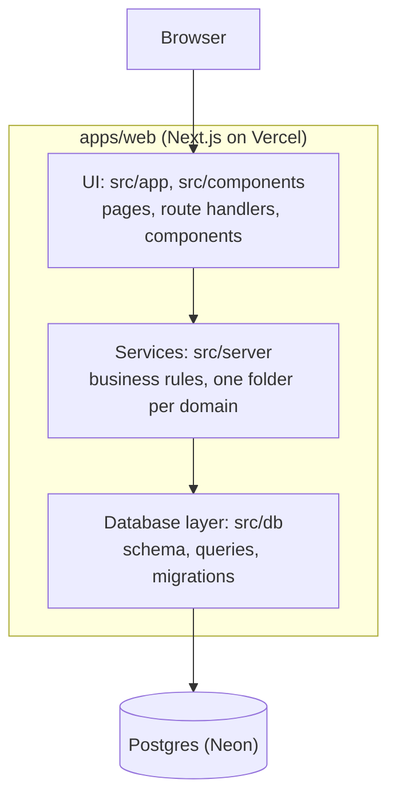

# Architecture

> Draft generated by the factory bootstrap. Revise it once `PURPOSE.md` exists.

## Principles

- **One deployable.** A modular monolith: one Next.js app, one Postgres database. Split only when a measured problem demands it.
- **Three layers, imports point down.** UI calls services; services call the database layer. Nothing reaches upward or skips a layer. ESLint enforces this (`apps/web/eslint.config.mjs`).
- **Deep modules.** A module exposes a small interface and hides its complexity. Callers never need to know how it works inside.
- **Simple for today's scale.** No queues, caches, or abstractions for load or variation we don't have.

## Layers

| Layer | Folder | Owns | May import |
|---|---|---|---|
| UI | `src/app`, `src/components` | Rendering, input handling, HTTP shape. `src/components/ui` holds shadcn/ui's components as its CLI wrote them; product components are composed from those (see `DESIGN.md`) | Services |
| Services | `src/server/<domain>` | Business rules and validation | Database layer |
| Database | `src/db` | Schema, queries, migrations | Nothing above it |

## Environments

- **Production:** `main`, deployed by Vercel on every merge that changes the app. A merge that changes only the factory's own folders (`factory/`, `.claude/`, `.github/`) is not built.
- **Preview:** every pull request that changes the app gets its own Vercel URL and its own branch of the database: a copy of production's schema and data that it can change freely. End-to-end tests run against it. Both are gone a day later.
- **Sign-in:** a product with accounts keeps them in Neon Auth, inside the same database, switched on at setup (`sign-in.sh`; `factory/decisions.md` [S287a](factory/decisions/287.md)). The app reads its address from `NEON_AUTH_BASE_URL` and signs cookies with `NEON_AUTH_COOKIE_SECRET`. A preview's database branch holds its own copy of the users, so a test signs nobody up in production.

Why a preview never shares the production database:

- **Migrations would run before review.** A pull request that drops or renames a column would do it to live data the moment its preview builds, whether or not it ever merges.
- **Tests would write into real data.** The end-to-end run on each preview creates and deletes records.
- **Pull requests would collide.** Two open pull requests with different schema changes would fight over one database.

So a migration is always exercised on a preview's branch first, and reaches production only by merging.

Every environment answers `GET /api/health` with `{ "status": "ok", "commit": … }`, never cached. `commit` is the git SHA the deployment was built from (`VERCEL_GIT_COMMIT_SHA`), or `"unknown"` where the platform provides none, such as a local run. Compare it with the merged commit to confirm a merge is live.

## Domain language

Use these names everywhere: code, tickets, UI copy. Add a row before introducing a new concept.

| Term | Meaning | States | Relates to |
|---|---|---|---|
| _none yet_ | | | |
