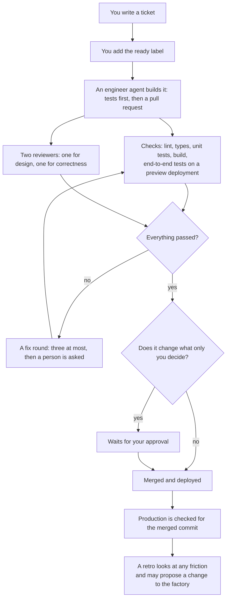

# tinyfactory

**Prove your idea before you pay for it.**

tinyfactory is a small software factory for the first version of a product. You write a ticket. AI agents build it test-first, review it, fix what the review finds, merge it and deploy it. You decide what gets built, and you are asked only when the agents cannot proceed or when a change is yours alone to decide.

It is for a technical founder who wants working software in front of users quickly, with tests, review and written decisions from the first commit, so the codebase is still worth keeping when the idea works.

> **Status: early.** tinyfactory was built inside one private project in five days in November 2026, and this repository is a copy of the factory's files from that project. There, agents wrote about 150 merged pull requests. Nobody has yet set up a second project from this repository from start to finish. Read [What works and what does not](#what-works-and-what-does-not) before you rely on it.

## How a change gets made



A pull request that passes merges without you. It waits for your approval only when it changes one of these:

- **spend or limits:** a model, a timeout, a free plan's limit, how many tickets run at once;
- **secrets or permissions:** a token, a workflow's permissions, the tools an agent may use;
- **the rule that decides this list;**
- **the product's quality bar:** `TASTE.md`, `DESIGN.md`, the theme, and the lint, TypeScript and test configuration;
- **`CLAUDE.md`,** the instructions every agent starts with.

Anything else that needs you is labelled `needs-human`, with a comment that says why.

## The agents

| Name | Role | What it does |
|---|---|---|
| Esme | Product engineer | Builds a product ticket test-first and opens the pull request. Fixes it when a check or a review fails. |
| Fred | Factory engineer | Builds a ticket that changes the factory itself: its scripts, skills, workflows and rules. |
| Adam | Reviewer, design | Judges whether the approach fits the codebase's architecture and design rules, and is sound. |
| Ryan | Reviewer, correctness | Checks that the pull request builds what its ticket asks and works: bugs, unhandled cases, security, tests that prove nothing. |
| Rosa | Researcher | Answers a research ticket from public sources and writes what she finds into the repository. |
| The retro | | After a run with friction, finds the cause, records a lesson, and proposes a change when the fault cost something or has happened before. |

Each agent is a Claude Code session that a GitHub Actions workflow starts, with one skill file as its instructions (`.claude/skills/`). They run the same model. They differ in their instructions, the tools they may use and the shape of the answer they must give. A reviewer can read and search; it cannot change a file or run the code it is reviewing.

## What a project gets

- **An app:** Next.js with TypeScript and Tailwind, shadcn/ui on a closed grey-scale theme (lint fails a colour that is not in the theme), Vitest, and Playwright with an accessibility scan on every end-to-end test.
- **Hosting:** a Vercel project. Every pull request that changes the app gets a preview deployment, and a merge deploys to production.
- **A database:** Neon Postgres, where each preview gets its own copy of the database, so a migration is tried before it reaches production. Sign-in through Neon Auth, unless you say the product has no accounts.
- **A board:** a GitHub project with the columns Backlog, In progress and Deployed, and views for what needs you and what the factory proposes.
- **Ticket templates:** Initiative, Bug, Tweak, Chore, Research and Factory. A ticket that changes behaviour carries numbered acceptance criteria, and each becomes a test written before the code.
- **Rule documents the project owns:** `PURPOSE.md` (written from an interview with you), `ARCHITECTURE.md`, `DESIGN.md`, `TASTE.md` and `CLAUDE.md`. Every ticket and review is judged against them.
- **The factory:** 15 workflows, 75 scripts with tests, 12 skills, and a record of every decision with its reason.

## What you need

- **Accounts:** GitHub (a personal account), Vercel (the free Hobby plan is enough), and a Claude subscription, which the agents run on. The database is created through Vercel's marketplace, so you need no separate Neon account.
- **The Claude GitHub App** installed on your GitHub account: <https://github.com/apps/claude>.
- **On your machine:** macOS or Linux, bash 4.4 or later, Node 20 or later, pnpm, git, jq, python3, Claude Code, the GitHub CLI (`gh`) logged in with the `repo`, `workflow` and `project` scopes, and a Vercel login (`npx vercel login`). macOS ships bash 3.2, so on a Mac run `brew install bash` first.

## Getting started

```sh
git clone https://github.com/edmulraney/tinyfactory.git
mkdir my-product && cd my-product
../tinyfactory/.claude/skills/bootstrap/scripts/bootstrap.sh
```

`bootstrap.sh` runs these steps in order. Each is a script you can run again safely, so after fixing a failure you run `bootstrap.sh` again.

| Step | What it does | What it asks of you |
|---|---|---|
| `preflight` | Checks every tool and login the rest needs. Changes nothing. | To fix what it lists |
| `scaffold` | Creates the app, copies in the factory's files and the seed documents, then proves the project lints, type-checks, passes its tests and builds. | Nothing |
| `purpose` | Opens a Claude Code session that interviews you about the product and writes `PURPOSE.md`. | To answer the interview |
| `github` | Publishes the folder as a private repository under your account and creates the factory's labels. | Nothing |
| `vercel` | Creates the Vercel project and connects it to the repository. | Nothing |
| `database` | Creates the Neon database through Vercel and gives each preview its own copy. | A few clicks for one setting no API can change |
| `database-key` | Stores a Neon key, limited to this one database, as a repository secret. | To approve a Neon sign-in in the browser |
| `sign-in` | Switches Neon Auth on, unless `PURPOSE.md` says the product has no accounts. | Nothing |
| `preview-access` | Lets the checks reach preview deployments. | Nothing |
| `board` | Creates the project board, its columns and its views. | To switch on the board's automations, which no API can do |
| `board-token` | Stores a token that can edit your project boards and nothing else. | To approve a one-time code in the browser |
| `workflow-app` | Creates a GitHub App that installs workflow changes, on this repository only. | Two clicks in the browser |
| `agent-token` | Stores a Claude subscription token as a repository secret, then proves an agent can run. | To approve in the browser |

The scripts are written never to print a secret or write one to disk.

The `bootstrap` skill (`.claude/skills/bootstrap/SKILL.md`) is written so that an agent can drive these steps and pass each approval on to you.

## Using it

1. **File a ticket.** Ask a Claude Code session in your project, which follows the `ticket` skill, or use an issue template.
2. **Add the `ready` label.** That starts the build. Three tickets are worked on at once at most; a fourth waits and starts by itself when a place frees.
3. **Watch the board, or walk away.** The ticket closes with the label `deployed` once production reports the merged commit.
4. **Answer what needs you.** Approve a pull request that waits for you, or submit a "Request changes" review and the engineer makes the changes.
5. **Read what the factory proposes.** A retro's proposal is a ticket written to be built as it is. Add `ready` to accept it, or close it.
6. **Take a change back** with `gh workflow run revert.yml -f number=<ticket>`. An engineer opens the pull request that reverts it.

`factory/README.md` is the full guide: the factory's mission and principles, every step above in detail, where everything lives and what the factory measures.

## What it costs

The mission is to test an idea on free plans. These are the limits, and what one project measured.

| Service | Free allowance | What uses it |
|---|---|---|
| GitHub Actions, private repository | 2,000 minutes a month | Every build, check, review and retro |
| Vercel, Hobby | 100 deployments a day | One preview for each push to a pull request that changes the app, one production deployment for each merge |
| Neon, Free | 10 database branches | One for each open pull request |
| Claude subscription | The plan's usage limits | Every agent. This is the one part that is not free |

In its first week the first project merged 55 tickets. Each took 51 Actions minutes and $6.68 of Claude usage at API prices, on average. At that rate 2,000 minutes build about 39 tickets a month. That project went through 2,000 minutes in three days of heavy use, and reached its Claude usage limit twice.

So at a few tickets a week it fits the free plans, and at dozens a day it does not. Cutting the minutes each ticket takes is the main work in progress. A public repository has no limit on Actions minutes; `bootstrap.sh` creates a private one.

`factory/free-tier.md` records each limit and every setting made to stretch it.

## What works and what does not

**Seen working in the first project**

- A product ticket became a deployed change with no person in between. The first was on 17 November 2026.
- Two reviewers with separate jobs found real problems before a merge, among them a database call that could hang forever and a setting that would have sent signed-in users to a stranger's site.
- A failed check or review starts a fix round. After three, a person is asked.
- A pull request merges without approval unless it changes one of the things listed above.
- After a run with friction, a retro proposes a change to the factory as a ticket ready to build.

**Not done, or not known**

- **One project and one account have run it.** From this repository, only the first two setup steps (`preflight` and `scaffold`) have been run. The others are the scripts that set the first project up, unchanged apart from names.
- **A personal GitHub account only.** "The owner" is the account that owns the repository. In an organisation that is the organisation, so your approvals would not count. Vercel's free plan also refuses to deploy a private repository that an organisation owns.
- **There is no `npx` installer.** You clone this repository and run a script.
- **You cannot yet set the order of waiting tickets by dragging cards.** The token the factory holds cannot read which ticket a card belongs to in a private repository. The ticket that has waited longest starts first.
- **A freed place is sometimes left empty** until the next event, because GitHub reports a merged ticket as open for a few seconds.
- **When the Claude usage limit is reached,** each waiting ticket starts in turn and stops. Nothing pauses the queue.
- **The stack is fixed:** Next.js, Vercel, Neon and GitHub. The model is named in the workflows (`factory/workflows/`).
- **The factory's scripts need bash 4.4 or later.** They are tested on Linux, as GitHub's runners are. With the bash 3.2 that macOS ships, 39 of their tests fail, so `preflight` asks a Mac for a newer bash.
- **The decision record cites tickets by number** (`#123`). They are tickets of the private repository this was built in, and you cannot open them. The decision, its reason and what was rejected are in the row itself.
- **This repository is a snapshot.** The factory is still being developed in the project it came from, and changes are copied here by hand.

## Where things are

| What | Where |
|---|---|
| The agents' instructions, and setup | `.claude/skills/` |
| Workflows | `factory/workflows/`. Setup copies them into a project's `.github/workflows/`. None of them runs in this repository, whose one workflow checks that the scaffold still works. |
| Scripts and their tests | `factory/scripts/`, `factory/tests/` |
| Why it is built this way | `factory/decisions.md` and `factory/decisions/`. `factory/scripts/decisions.sh` prints the whole record. |
| Free plans, and what stretches them | `factory/free-tier.md` and `factory/free-tier/` |
| What still needs a person | `factory/manual-steps.md` |
| Ticket and pull request templates | `.github/` |
| The few app files the factory owns | `apps/web/` |
| The seed documents for a new project | `.claude/skills/bootstrap/templates/` |

## Licence

MIT. See [LICENSE](LICENSE).
