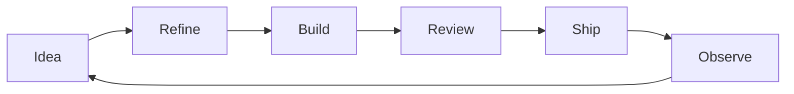

# tinyfactory

**Prove your idea before you pay for it.**

```sh
npx tinyfactory my-idea
```

One command sets up, on free tiers:

- a GitHub repository and a project board;
- a factory in it, with sandboxed AI agents for product, engineering, research, architecture review and correctness review;
- a web app hosted on Vercel;
- a database and sign-in on Neon Postgres and Better Auth (through Neon Auth).

You bring a Claude subscription. Nothing else costs anything.

tinyfactory is a small software factory for a technical founder, or a tiny team, with an idea. You bring the idea. AI agents refine it into tickets, build them, review them and ship them. You stay near the loop instead of in it: you decide what gets built, and you are asked only when a decision is yours.

It is deliberately narrow. Its job is to get an MVP validated with real users at zero cost, without the slow decay into slop that agents produce when they build a product by themselves. It is not an enterprise factory. If the idea gets traction, you carry on building in the same factory, on the same stack.

> **Status: early.** tinyfactory is being built with tinyfactory. It grew inside one private project in November 2026, where agents wrote all but two of its first 150 pull requests, and this repository is a copy of its files. Build, review and ship work. Refine is new. Observe is not built yet. [The first post about it](https://emul.dev/writing/introducing-tinyfactory/) says what it is for and how it is built.

## The loop



| Step | Who | What happens |
|---|---|---|
| Idea | You or an agent | A ticket is added to the board. A rough idea is enough: who has the problem, what would change for the business, and notes. |
| Refine | Peta, the product agent | She turns a rough idea into small tickets with acceptance criteria, and asks you for the decisions that are yours. |
| Build | Esme, the product engineer | She writes the acceptance tests first, then the change, and opens a pull request. Fred does the same for a change to the factory itself. |
| Review | Scripts, then Adam and Ryan | Lint, types, unit tests, a build, and end-to-end tests on a preview deployment. Adam reviews architecture and Ryan reviews correctness. A failure starts a fix round; after three, a person is asked. |
| Ship | The factory | The pull request merges and deploys, and the factory checks that production runs the merged commit. |
| Observe | Not built yet | An incident or a bug in production will become a ticket. |

Two more agents work beside the loop. Rosa answers a research ticket from public sources. The retro looks at a run that went wrong and proposes a change to the factory.

## Product, as well as engineering

The work is geared to customer outcomes, and each project's repository holds what that needs:

- **`PURPOSE.md`** says who the product is for and what it will not do. Setup writes it from an interview with you.
- **`product/`** holds research, signals and product decisions. Give the `intake` skill the notes of a user interview, and it writes a summary, adds the evidence to the signals, and files a ticket only where the evidence justifies building now.
- **A feature ticket** states the problem, a hypothesis and a success metric, with acceptance criteria that say what a user sees or does.
- **The board** shows where every ticket is.

Every agent starts from the purpose and from its ticket, so the engineer acts as a product engineer who knows why a change matters.

## How it is built

**Events drive it.** The GitHub project board is where you run the factory from. You or an agent add a ticket. You add the `ready` label, and that event starts a workflow in which an engineer picks the ticket up. Every later step starts from an event too: a pull request opens, a check fails, a review passes, a merge lands.

**Skills, then workflows, then the factory.** A skill is the instructions for one job (`.claude/skills/`). A workflow runs an agent with one skill when its event arrives (`factory/workflows/`). The factory is those workflows together.

**Every agent runs in a sandbox.** Each one is a Claude Code session on its own GitHub Actions runner, with only the permissions and tools its workflow grants. A reviewer can read and search; it cannot change a file or run the code it reviews.

## How quality is kept

**A script before an agent.** Whatever a linter, a test or a script can decide, it decides. A script costs no tokens and gives the same answer on every run. Agents are kept for what needs judgement.

**Two reviewers with different jobs.** Adam judges whether the approach fits the codebase's architecture and design rules. Ryan checks that the change does what its ticket asks and that it works.

**As few pull requests as possible wait for you.** A pull request that passes its checks and both reviews merges by itself, unless it changes one of these:

- **spend or limits:** a model, a timeout, a free plan's limit, how many tickets run at once;
- **secrets or permissions:** a token, a workflow's permissions, the tools an agent may use;
- **the rule that decides this list;**
- **the product's quality bar:** `TASTE.md`, `DESIGN.md`, the theme, and the lint, TypeScript and test configuration;
- **`CLAUDE.md`,** the instructions every agent starts with.

Anything else that needs you is labelled `needs-human`, with a comment that says what to do.

**The rules are files.** Each project owns `PURPOSE.md`, `ARCHITECTURE.md`, `DESIGN.md`, `TASTE.md` and `CLAUDE.md`, and every ticket and review is judged against them. An agent starts each task with no memory, so what is written down is all it knows.

## How it improves

After a run that went wrong or cost more than it should, the retro finds the cause and proposes a change to the factory as a ticket. The factory builds that ticket like any other. `factory/decisions.md` records every decision with its reason and what was rejected.

## What a project gets

- **An app:** Next.js with TypeScript, Tailwind and shadcn/ui, with Vitest and Playwright set up and an accessibility scan on every end-to-end test.
- **Hosting and a database:** a Vercel project and Neon Postgres. Every pull request that changes the app gets a preview deployment with its own copy of the database.
- **Sign-in:** Neon Auth switched on, for sign-in by an emailed link, unless you say the product has no accounts.
- **A board and ticket templates:** a GitHub project with the columns Backlog, In progress and Deployed, and templates for Idea, Initiative, Bug, Tweak, Chore, Research and Factory tickets.

## What you need

- **Accounts:** GitHub (a personal account), Vercel (the free Hobby plan is enough), and a Claude subscription, which the agents run on. The database is created through Vercel's marketplace, so you need no separate Neon account.
- **The Claude GitHub App** installed on your GitHub account: <https://github.com/apps/claude>.
- **On your machine:** macOS or Linux, Node 20 or later, pnpm, git, jq, python3, Claude Code, the GitHub CLI (`gh`) logged in with the `repo`, `workflow` and `project` scopes, and a Vercel login (`npx vercel login`).

## Getting started

```sh
npx tinyfactory my-idea
```

The command makes the folder `my-idea` and runs the setup in it. It checks your tools and logins, creates the app, interviews you about the product and writes `PURPOSE.md`. It then sets up the repository, hosting, the database, sign-in, the board and the agents' access, and asks you for a few approvals in the browser. Every step is safe to run again, so after fixing what a step reports, run the same command again. The scripts are written never to print a secret or write one to disk. `.claude/skills/bootstrap/SKILL.md` describes every step.

To run the newest commit of this repository instead of the published package: `npx github:edmulraney/tinyfactory my-idea`.

## Using it

1. **Start with an idea or a ticket.** Open an issue with the Idea template, and Peta proposes the tickets and the decisions that are yours; answer her, or say "go", and she files them. Or file a ticket yourself with one of the other templates.
2. **Add the `ready` label** to a ticket to start its build. Three tickets are built at once at most, and the rest wait their turn.
3. **Answer what needs you:** approve a pull request that waits for you, or submit a "Request changes" review and the engineer makes the changes.
4. **Read what the factory proposes.** A retro's proposal is a ticket written to be built as it is. Add `ready` to accept it, or close it.
5. **Ask for help** in a comment that holds `@claude`.
6. **Take a change back** with `gh workflow run revert.yml -f number=<ticket>`.

`factory/README.md` is the full guide.

## Built around the free tiers

The free tiers are the constraint the factory is designed around, so it is tuned to stretch them and keep you shipping without reaching a limit:

- **GitHub Actions minutes:** it runs only the checks a change can affect, and moves the board's cards with GitHub's own automations.
- **Vercel deployments:** it builds no preview for a change that touches no app code.
- **Neon database branches:** it keeps previews for a day, and builds three tickets at a time at most.

That tuning is still going on, and heavy use can still reach a limit. A public repository has no limit on Actions minutes; setup creates a private one. `factory/free-tier.md` records each limit and every setting made to stretch it.

## Known gaps

- **Visual design is not covered.** A project starts with `DESIGN.md`, a fixed grey-scale theme and an accessibility scan. Nothing yet keeps taste in how a product looks, feels and moves.
- **A personal GitHub account only.** In an organisation your approvals would not count as the owner's, and Vercel's free plan refuses to deploy a private repository that an organisation owns.
- **The stack is fixed,** and the model is named in the workflows.
- **You cannot yet order waiting tickets by dragging cards.** The ticket that has waited longest starts first.
- **Nothing pauses the queue when the Claude usage limit is reached.**
- **The decision record cites tickets by number** (`#123`). They belong to the private project this was built in, so you cannot open them; each row carries its reason.
- **The factory does not run in this repository yet.** The files here are a copy from the project the factory was built in. The plan is for tinyfactory to build tinyfactory here.

## Where things are

| What | Where |
|---|---|
| The agents' instructions, and setup | `.claude/skills/` |
| Workflows | `factory/workflows/`. Setup copies them into a project's `.github/workflows/`. None of them runs in this repository, whose one workflow checks that the scaffold still works. |
| Scripts and their tests | `factory/scripts/`, `factory/tests/` |
| Why it is built this way | `factory/decisions.md` and `factory/decisions/` |
| Free plans, and what stretches them | `factory/free-tier.md` and `factory/free-tier/` |
| What still needs a person | `factory/manual-steps.md` |
| Ticket and pull request templates | `.github/` |
| The seed documents for a new project | `.claude/skills/bootstrap/templates/` |

## Licence

MIT. See [LICENSE](LICENSE).
