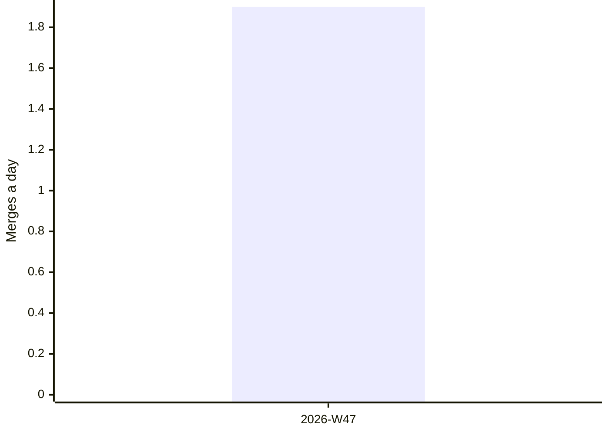
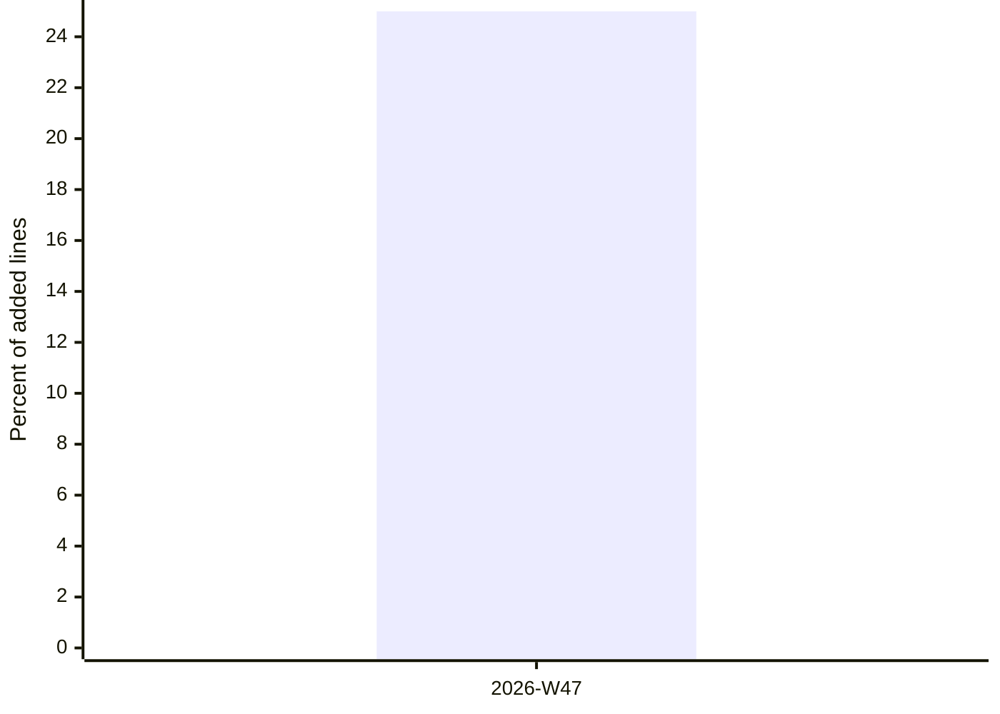
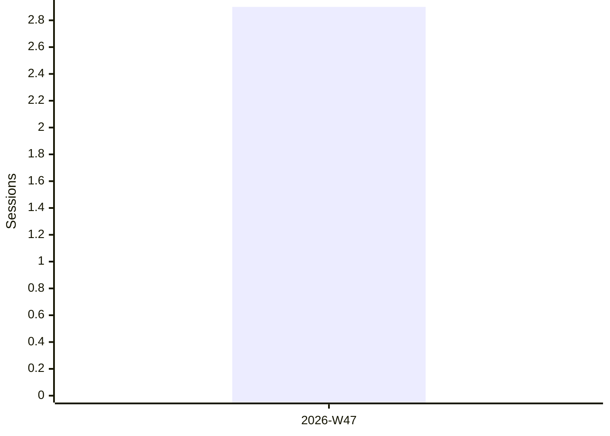
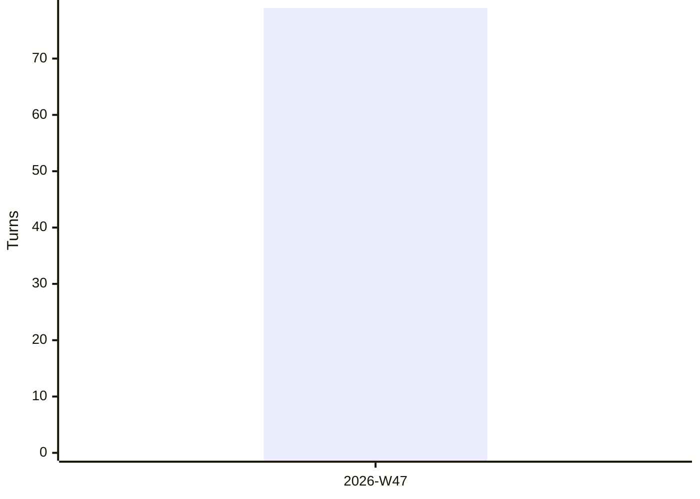
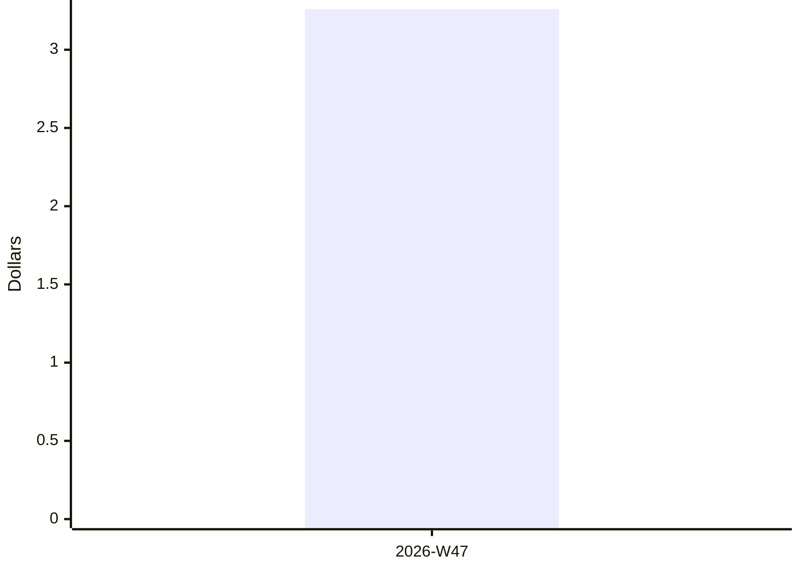

# The factory's delivery numbers by week

`factory/scripts/metrics.sh` writes this page from what GitHub and git hold. A week is an ISO week that has ended, UTC, and holds the pull requests merged in it. The first four measures are those of DORA. The last five are means over the pull requests whose measures `measures.jsonl` recorded at their merge.

## Merges a day

The pull requests merged into `main` in the week, divided by its seven days.



| Week | Merges a day | Counted over |
|---|---|---|
| 2026-W47 | 1.9 | 13 merges |

## Time from `ready` to deployed

The mean time from the first `ready` label on a ticket to the `deployed` label its merge led to. A ticket that deployed nothing is left out.

No week holds this measure yet.

## Merges followed by a bug ticket or a revert

The share of the merges of the week that a later ticket labelled `bug` names, by the number of the pull request or of its ticket, or that a later pull request took back.

```mermaid
xychart-beta
  x-axis ["2026-W47"]
  y-axis "Percent of merges" 0 --> 1
  bar [0]
```

| Week | Percent of merges | Counted over |
|---|---|---|
| 2026-W47 | 0 | 0 of 13 merges |

## Rework

The share of the lines added by the pull requests of product tickets merged in the week that the pull requests merged after each, ten at most, changed or deleted (`factory/scripts/quality.sh`).



| Week | Percent of added lines | Counted over |
|---|---|---|
| 2026-W47 | 25 | 1 of 4 added lines |

## Fix rounds for each pull request

The mean number of fix rounds, those the owner asked for included.

```mermaid
xychart-beta
  x-axis ["2026-W47"]
  y-axis "Fix rounds" 0 --> 1
  bar [0]
```

| Week | Fix rounds | Counted over |
|---|---|---|
| 2026-W47 | 0 | 12 recorded pull requests |

## Agent sessions for each pull request

The mean number of agent sessions whose transcript gave a cost.



| Week | Sessions | Counted over |
|---|---|---|
| 2026-W47 | 2.9 | 12 recorded pull requests |

## Turns for each pull request

The mean number of turns the agents took, over every transcript kept for the pull request and its ticket.



| Week | Turns | Counted over |
|---|---|---|
| 2026-W47 | 79 | 12 recorded pull requests |

## Actions minutes for each pull request

The mean number of Actions minutes billed for the runs of the pull request and its ticket.


| Week | Minutes | Counted over |
|---|---|---|
| 2026-W47 | 34.3 | 12 recorded pull requests |

## Claude cost for each pull request

The mean Claude usage at API prices.



| Week | Dollars | Counted over |
|---|---|---|
| 2026-W47 | 3.26 | 12 recorded pull requests |
